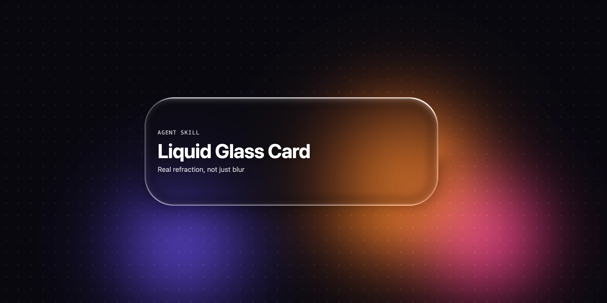

<div align="center">

<a href="liquid-glass-card/"></a>

# pyamir

**Agent skills that produce work you would ship.**<br>
For Claude Code, Codex, claude.ai and any agent that reads [Agent Skills](https://agentskills.io).

[](https://github.com/amir-afianian/pyamir.io/actions/workflows/ci.yml)
[](LICENSE)

</div>

---

Each skill here is a focused piece of craft: a prompt that encodes the decisions, plus the template, references and tests that make the result reliable. Every skill has a live demo at [pyamir.io](https://pyamir.io).

## Skills

| | Skill | What it builds |
| --- | --- | --- |
| <a href="liquid-glass-card/"></a> | **[Liquid Glass Card](liquid-glass-card/)**<br>[Playground](https://pyamir.io/liquid-glass-card/) | Real-refraction liquid glass cards for the web, SwiftUI and Claude Design, from one sentence. A WebGL shader bends the light at the glass edge instead of only blurring it. |

## Install

This repo is one marketplace named `pyamir`. Add it once, then install any skill from the table by name.

| Where your agent runs | Install |
| --- | --- |
| **Claude Code** | `/plugin marketplace add amir-afianian/pyamir.io`<br>`/plugin install <skill>@pyamir` |
| **Codex** | `codex plugin marketplace add amir-afianian/pyamir.io`<br>`codex plugin add <skill>@pyamir` |
| **Any Agent Skills agent** | `npx skills add amir-afianian/pyamir.io --skill <skill>` |

Each skill's README has its exact commands and a zip for claude.ai.

## Repository layout

```
.claude-plugin/, .agents/plugins/   the Claude Code and Codex marketplaces
<skill>/plugin/                     what installs: the plugin manifests and skills/
<skill>/                            around it: README, tests, demo site, tooling
media/<skill>/                      README images, rendered from the real templates
scripts/                            manifest checks, the pyamir.io build and deploy
```

Each skill is versioned and released on its own, with tags like `liquid-glass-card-v1.0.0`.

## Contributing

Issues and pull requests are welcome. [CONTRIBUTING.md](CONTRIBUTING.md) covers commit conventions, checks and releases; [SECURITY.md](SECURITY.md) covers private vulnerability reports. Everyone taking part follows the [Code of Conduct](CODE_OF_CONDUCT.md).

## License

[MIT](LICENSE) © 2026 Amir Afianian
