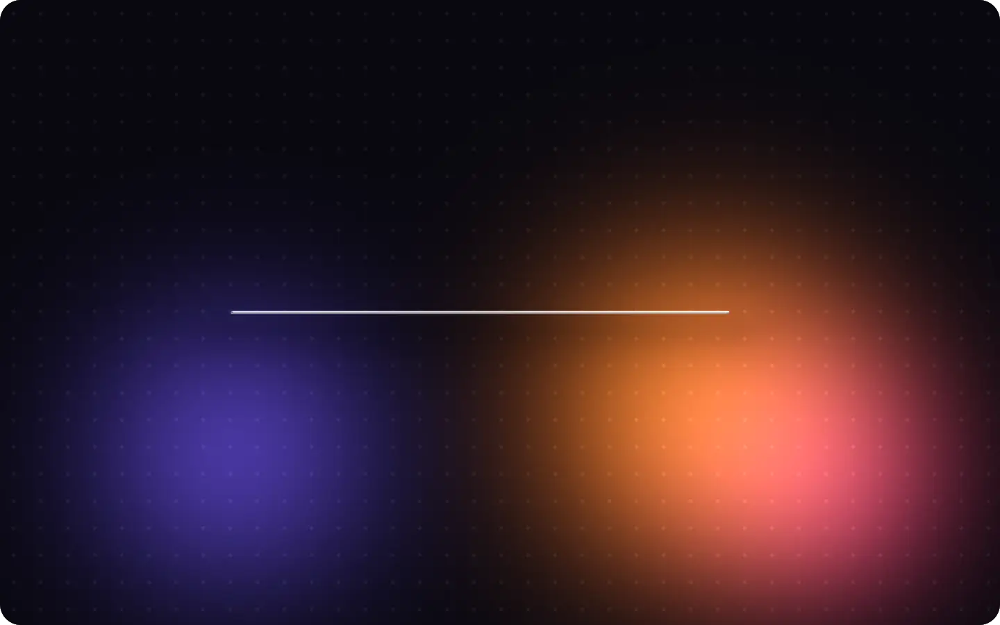
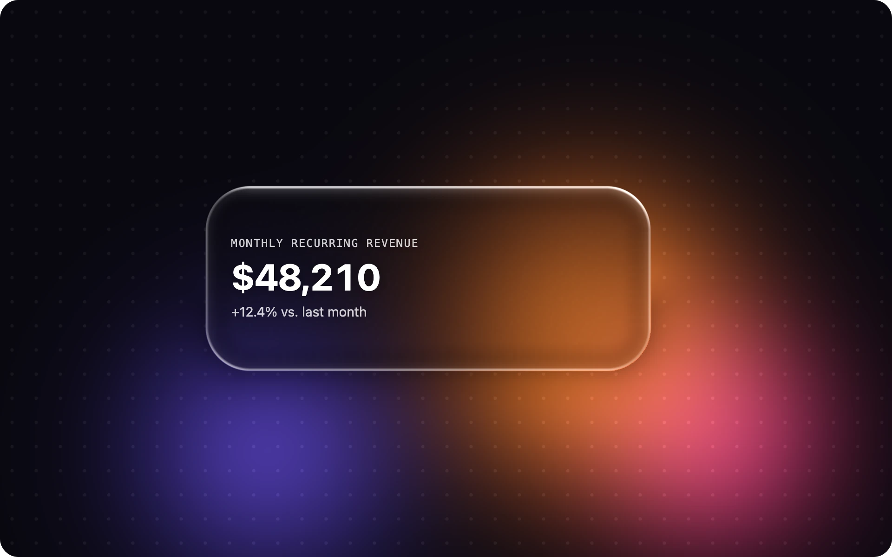
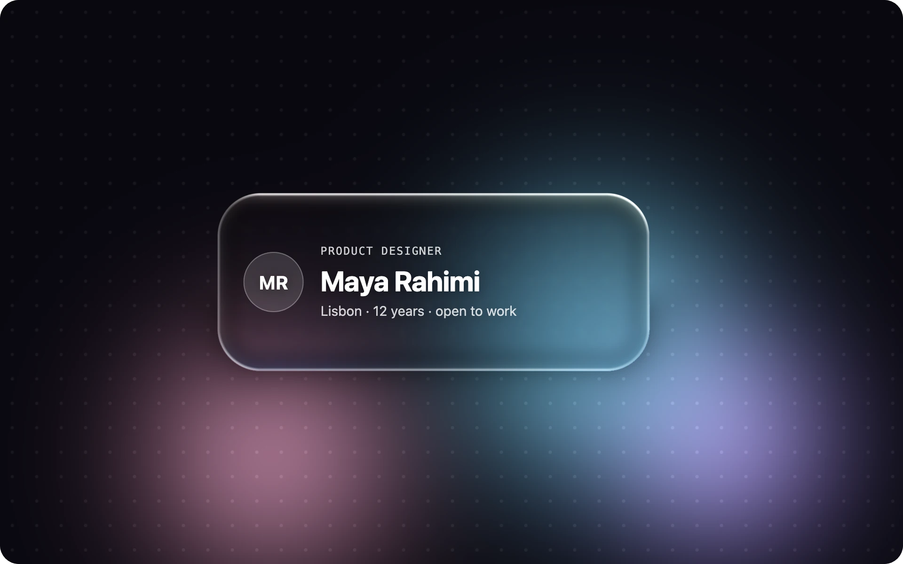
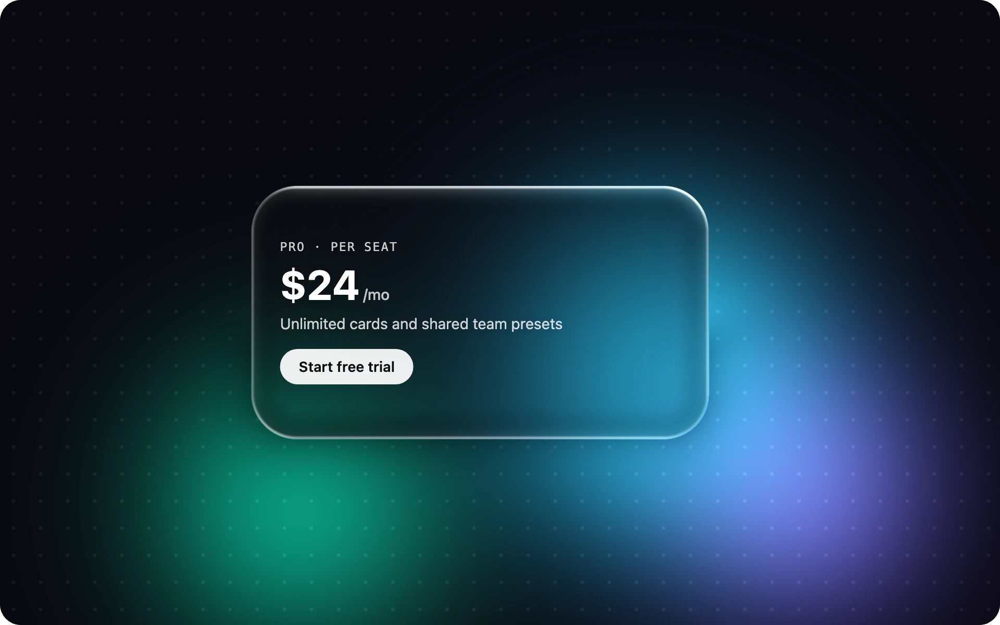
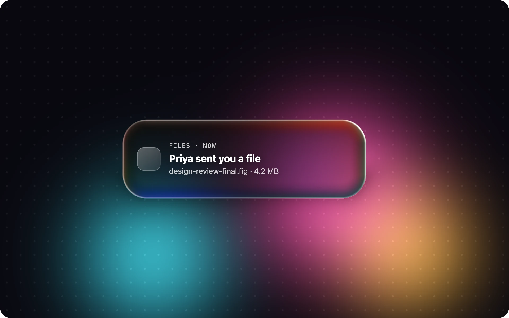
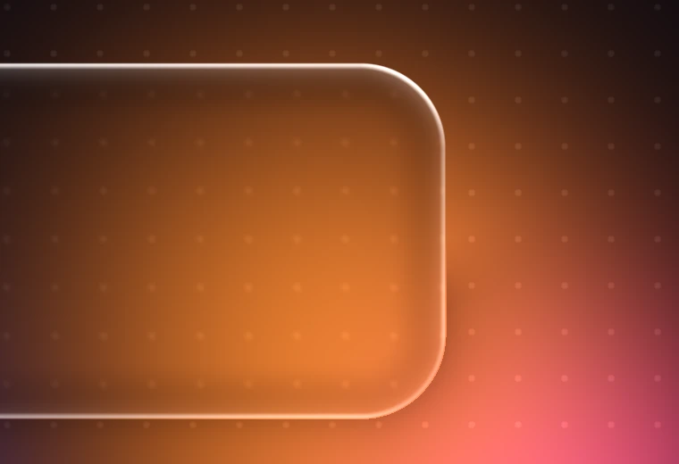
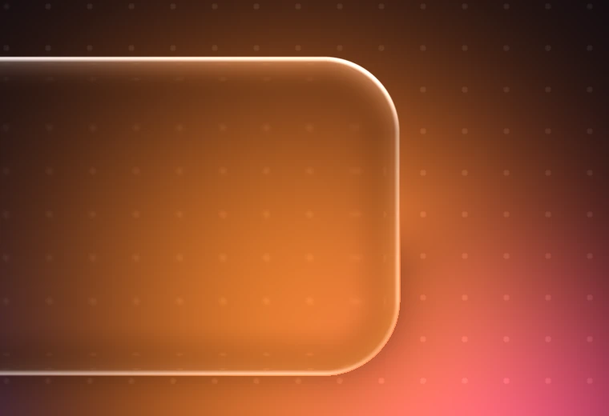

<div align="center">

<a href="https://pyamir.io/liquid-glass-card/"></a>

# Liquid Glass Card

**Real refraction, not just blur.**<br>
An agent skill that builds liquid glass cards for the web, SwiftUI and Claude Design from one sentence.

[](https://github.com/amir-afianian/pyamir.io/actions/workflows/ci.yml)
[](https://github.com/amir-afianian/pyamir.io/releases?q=liquid-glass-card)
[](LICENSE)
[](https://agentskills.io)

[**Open the playground**](https://pyamir.io/liquid-glass-card/) · [Install](#install) · [How it works](#how-it-works) · [Tuning](#tuning)

</div>

---

Ask your agent for *"a liquid glass card showing MRR $48k"* and you get one self-contained HTML file: frosted glass that bends the light behind it, a soft colour glow, a specular rim and a spring bounce-in. No libraries, no build step. It runs in Chrome, Safari and Firefox, and the card is draggable.

## What it builds

Each image is one of the playground's presets. Click it to open that exact look and tune it live.

<table>
  <tr>
    <td width="50%"><a href="https://pyamir.io/liquid-glass-card/#r=20&f=14&d=0&l=300&t=0.35&g=ff6b14,f22e73,5940ff&i=1.25,0.85,0.7&n=1&c=metric"></a><br><b>Original</b> · the tutorial's look · refraction 20, frost 14</td>
    <td width="50%"><a href="https://pyamir.io/liquid-glass-card/#r=26&f=5&d=6&l=300&t=0.2&g=6ad4ff,a78bfa,ff9ec7&i=0.85,0.8,0.7&n=1&c=profile"></a><br><b>Apple clear</b> · clearer glass, a touch of dispersion</td>
  </tr>
  <tr>
    <td width="50%"><a href="https://pyamir.io/liquid-glass-card/#r=45&f=10&d=0&l=300&t=0.4&g=17c3ff,6b5bff,00e0a4&i=1.3,0.95,0.8&n=1&c=pricing"></a><br><b>Showy liquid</b> · refraction 45 for a thicker lens</td>
    <td width="50%"><a href="https://pyamir.io/liquid-glass-card/#r=30&f=12&d=40&l=320&t=0.4&g=ff3d9a,ffb02e,2ee6ff&i=1.2,0.9,0.9&n=1&c=notification"></a><br><b>Rainbow edge</b> · dispersion 40 splits the rim into colour</td>
  </tr>
</table>

## Real refraction, not just blur

Most glass UI is CSS `backdrop-filter`: it blurs what is behind the panel and stops there. Real glass also bends light at its edges. This card is drawn by a shader that models the edge as a lens, so the background warps where the glass curves and stays straight in the middle.

| Blur only (refraction 0) | Refraction 55 |
| :---: | :---: |
|  |  |

Same glows, same rim, nearly clear glass. Watch the dot grid where it meets the right edge: on the left it runs straight under the rim, on the right the edge pulls it in.

## Install

| Where your agent runs | Install |
| --- | --- |
| **Claude Code** | `/plugin marketplace add amir-afianian/pyamir.io`<br>`/plugin install liquid-glass-card@pyamir` |
| **Codex** | `codex plugin marketplace add amir-afianian/pyamir.io`<br>`codex plugin add liquid-glass-card@pyamir` |
| **Any [Agent Skills](https://agentskills.io) agent** | `npx skills add amir-afianian/pyamir.io --skill liquid-glass-card` |
| **claude.ai** | Download `liquid-glass-card.zip` from the [latest release](https://github.com/amir-afianian/pyamir.io/releases?q=liquid-glass-card) and upload it in claude.ai's skill settings. |

## Use

Ask in plain words. The skill picks the colours, the strength and the card layout, then tells you in one line what it chose, so you can ask for changes in the same terms.

> Make a liquid glass card showing MRR $48k
>
> A glass pricing card in blue, showier refraction
>
> Liquid glass notification card for SwiftUI
>
> Same card, but clearer glass and rainbow edges

It also picks the right technique for where the card will live:

| You ask for | You get |
| --- | --- |
| A card, no platform named | The WebGL template: one HTML file, or a component in your codebase |
| SwiftUI or iOS | Apple's native Liquid Glass (`glassEffect`, iOS 26+), with a Metal shader route for the stronger look and `ultraThinMaterial` below iOS 26 |
| Glass over live page content (a navbar, a card over a photo) | A CSS tier with frost and rim, and a clear note that CSS cannot bend light portably |
| An Artifact page or a Claude Design canvas | The live WebGL card wired into the canvas runtime, with tweakable glow, refraction, frost and dispersion |

## How it works

Think of a thick glass coaster on a dark table, lit by a coloured lamp. Each physical fact is one layer of the shader:

| Layer | What you see |
| --- | --- |
| **Glow** | One to three soft colour blobs on a near-black ground: the lamp |
| **Frost** | The glow behind the card, blurred to no detail |
| **Tint** | A near-black base mixed in at about 35%, so white text stays readable |
| **Refraction** | The background bends near the edges only, never in the centre |
| **Specular rim** | A 1 to 2 px light line, brightest on the side facing the light |
| **Motion** | A vertical grow-in with an overshoot bounce, and a slow drift in the glow |

The card is a rounded-rectangle signed distance field. Inside it, the field's normal pushes background samples outward near the edge (refraction), nine samples in a spiral blur them (frost), and red and blue sample at slightly different offsets (dispersion). The background is a function rather than a texture, so the shader can look "behind" the glass at any offset without reading the page. That is why it works the same in every browser, and why the card does not need WebGL extensions.

Without WebGL, the card falls back to CSS glass. With `prefers-reduced-motion`, it skips the bounce and the drift.

## Tuning

Every setting lives in one `LG_CONFIG` object at the top of the generated file. The script also exposes it as `stage.lgConfig`, and edits there apply on the next frame, which is how the playground works. Only the card's starting position and `draggable` are read once at load.

```js
glass: { refraction: 20, dispersion: 0, frost: 14, lightAngle: 300, tint: "#0a0a0f", tintAmount: 0.35 },
```

| Setting | Range | Effect |
| --- | --- | --- |
| `refraction` | 0–60 | 15–25 matches the original video; 35–50 is a showier liquid lens |
| `frost` | 0–30 | 10–18 is frosted; 4–8 is clear glass |
| `dispersion` | 0–60 | 0 keeps the rim white; 30–50 adds rainbow edges |
| `lightAngle` | 0–360° | Which edge of the rim is brightest; aim it at the main glow |
| `tintAmount` | 0–0.8 | Raise it toward 0.5 if the text needs more contrast |
| `glows` | up to 3 | Colour, position, size and intensity of each light blob |

## Accessibility and performance

- The visible text sits in an `aria-hidden` overlay above the canvas, and the stage carries a real `aria-label`. The skill writes one that matches your content.
- The skill checks text contrast against the brightest glow behind the card (WCAG 4.5:1) and raises the tint when it falls short.
- Each card is one fragment shader pass over its stage per frame. A few live glass layers per screen is the practical limit on phones; for more, the skill uses the WebGL card as the hero and CSS glass for the rest.

## Development

The skill lives in [`skills/liquid-glass-card/`](skills/liquid-glass-card/), the playground in [`site/`](site/), and the tests in [`tests/`](tests/). The images in this README are rendered from the real template by `node scripts/render-media.mjs`. Commit conventions, checks and the release flow are in [CONTRIBUTING.md](../CONTRIBUTING.md).

## Credits

The look comes from Stephan Zammit's After Effects tutorial [Vibrant Glass UI](https://www.youtube.com/watch?v=fJJ6YhaUWB8), checked against frames of the video and rebuilt as a live WebGL shader.

## License

[MIT](LICENSE) © 2026 Amir Afianian
